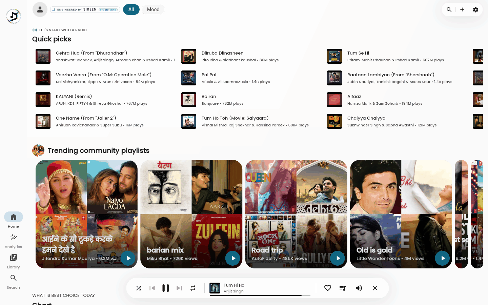
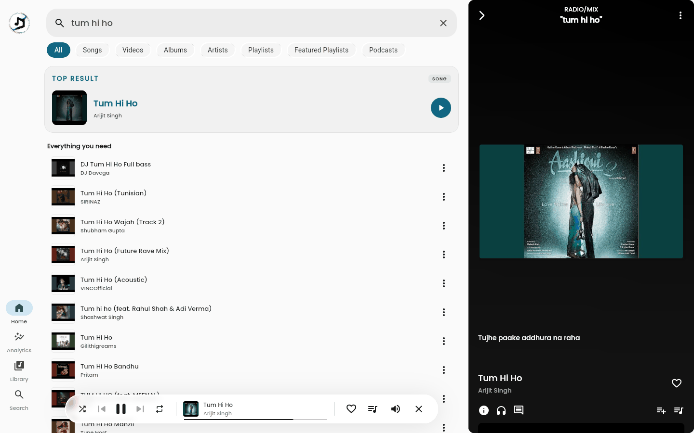
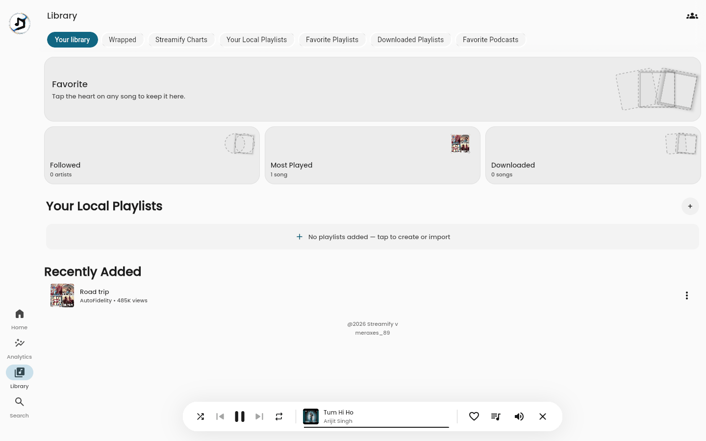
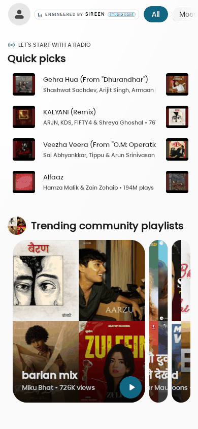
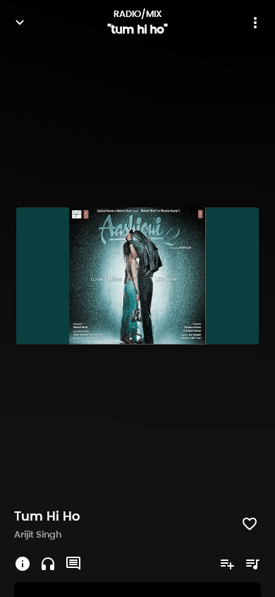
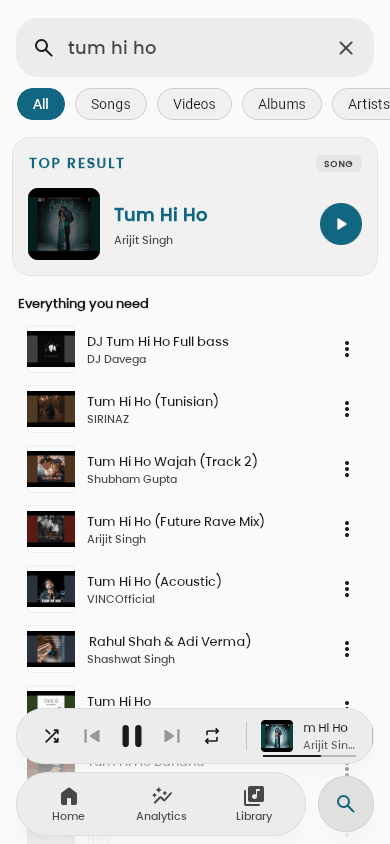

# Streamify

Streamify is a free music streaming client built with Kotlin Compose
Multiplatform. It plays YouTube Music catalogs, renders synchronized lyrics,
and keeps a local-first library that syncs to Supabase. Audio processing is
Kotlin on Android (`AudioProcessor` chain) and ffmpeg filters through libmpv on
Desktop; there is no native DSP core in the shipped app
([ADR-009](docs/adr/ADR-009-kotlin-only-audio-pipeline.md)). Start exploring at
the [23-subsystem index](docs/SYSTEMS.md). The project descends from SimpMusic;
the shared data/domain modules arrive through the `core` git submodule
(`maxrave-dev/core`) with a local patch (`core.patch`) applied on top.

## UI showcase — Liquid Glass (BETA)

The same Compose Multiplatform UI reflows from a 1440 × 900 desktop canvas
down to a 390 × 844 phone: an adaptive navigation rail, a floating
**Liquid Glass (BETA)** mini-player pill, and the frosted-glass treatment
wherever panels dock over content. Enable it under
`Settings → Appearance → Enable liquid glass (BETA)`
(or set `localStorage.enableLiquidGlass = "true"` on the wasm shell) and the
translucent glass surfaces pick up the artwork and feed behind them.

<table>
  <tr>
    <td width="50%" align="center"><em>Desktop — Home / Discover</em></td>
    <td width="50%" align="center"><em>Desktop — Now Playing</em></td>
  </tr>
  <tr>
    <td width="50%"><a href="asset/screenshot/desktop/desktop-home.png"></a></td>
    <td width="50%"><a href="asset/screenshot/desktop/desktop-player.png"></a></td>
  </tr>
</table>

<p align="center">
  <a href="asset/screenshot/desktop/desktop-library.png"></a><br>
  <em>Desktop — Library</em>
</p>

<table>
  <tr>
    <td width="33%" align="center"><em>Mobile — Home</em></td>
    <td width="33%" align="center"><em>Mobile — Now Playing</em></td>
    <td width="33%" align="center"><em>Mobile — Search</em></td>
  </tr>
  <tr>
    <td width="33%" align="center"><a href="asset/screenshot/mobile/mobile-home.png"></a></td>
    <td width="33%" align="center"><a href="asset/screenshot/mobile/mobile-player.png"></a></td>
    <td width="33%" align="center"><a href="asset/screenshot/mobile/mobile-search.png"></a></td>
  </tr>
</table>

<sub>Captured against the live wasmJs shell with Liquid Glass (BETA) enabled; viewports 1440 × 900 (desktop) and 390 × 844 (mobile). The phone bottom bar in the wasm demo keeps its flat variant — the folding glass bar ships on the Android/iOS/desktop shells.</sub>

```
Platform shells                 androidApp, vivoAndroidApp, desktopApp,
                                composeApp (wasmJs browser, iOS framework)
        │ Koin DI, shared settings snapshots (immutable values)
        ▼
Playback + DSP                  Android: Media3 AudioProcessor chain (Kotlin)
                                Desktop: libmpv via JNA + ffmpeg af graphs
        │ PCM16 (8D also accepts PCM_FLOAT) / platform audio device
        ▼
Platform audio output           AudioTrack / mpv audio output / cast
Side planes: Room SQLite (WAL) <-> Supabase Postgres (LWW, RLS, RPC)
             server/ Fastify modular monolith (6 slices) + web bundle gate
```

> **HISTORICAL:** the `rust/` workspace and `native/` C++20 DSP layer were
> removed (commit `50b937f7`; [ADR-009](docs/adr/ADR-009-kotlin-only-audio-pipeline.md)).
> Older prose in `docs/architecture/ARCHITECTURE.md` and engine spec 02
> describes them as lineage, not current state.

## Build in 60 seconds (Android debug APK)

Prerequisites: JDK 21, Android SDK with compileSdk 37, git. The Gradle wrapper
(9.8.1) fetches itself.

```bash
git clone --recursive https://github.com/meraxes89/streamify-apk.git
cd streamify-apk
git -C core apply ../core.patch     # same patch CI applies to the submodule
./gradlew :androidApp:assembleDebug
# androidApp/build/outputs/apk/debug/androidApp-debug.apk
```

Audio playback runs on the Kotlin Media3 `AudioProcessor` pipeline on Android
and `libmpv` via JNA on Desktop.

Other targets:

```bash
./gradlew :androidApp:testDebugUnitTest                                  # JVM tests
./gradlew :desktopApp:packageDistributionForCurrentOS                   # desktop installers
cd server && npm ci && npm start                                         # relay on :3000
```

## Repository layout

| Directory | Contents |
|---|---|
| [androidApp/](androidApp/README.md) | Android shell: manifest, Media3 services, widgets, release signing, vivo store variant |
| [composeApp/](composeApp/README.md) | Compose Multiplatform UI, ViewModels, navigation, Koin graph, sync engine |
| [streamify-modules/](streamify-modules/README.md) | Downstream extension suite (Koin IoC, media HAL, lyrics, Supabase, jam, ffmpeg shim) |
| [desktopApp/](desktopApp/README.md) | Compose Desktop entry point, Conveyor packaging, memory tuning |
| [server/](server/README.md) | Fastify relay, stream gateway, content-addressed WASM bundle delivery |
| [supabase/](supabase/README.md) | Postgres schema, RLS policies, realtime publications, LWW upserts |
| [scripts/](scripts/README.md) | CI harnesses, ABI parity gates, golden-vector generators, doc verification |
| [docs/](docs/README.md) | Architecture map, ADRs, playbooks, archive |
| core/ (submodule) | Upstream `maxrave-dev/core`: Room database, repositories, media3 service |
| legacy/ | Archived pre-multiplatform code, not part of the build |

## Documentation index

- [Subsystem index](docs/SYSTEMS.md) — **start here**: S01–S23 with owner, boundaries and links
- [Documentation contract](docs/README.md) — four doc types, decision table, drift protocol
- [System architecture map](docs/architecture/ARCHITECTURE.md) — master layer map (contains historical native-core notes)
- [Architecture Decision Records](docs/adr/README.md) — ADR-001 through ADR-009
- [RFC index](docs/rfc/README.md) — proposals, accepted or rejected
- [Idea log](docs/IDEA_LOG.md) — append-only intake for daily ideas
- [Subsystem deep-dives](docs/architecture/engines/) — 13 engine documents (verify against the tree before trusting claims)
- [Developer playbooks](docs/playbooks/) — feature recipes, CI guide, codebase tour
- [Project philosophy](docs/PHILOSOPHY.md)
- [Hybrid sync architecture](supabase/HYBRID_SYNC_ARCHITECTURE.md)
- [Contributing](CONTRIBUTING.md), [Security policy](SECURITY.md), [Code of conduct](CODE_OF_CONDUCT.md)

Releases are published through the unified CI pipeline under
[GitHub Releases](https://github.com/meraxes89/streamify-apk/releases).
Streamify is licensed under the [MIT License](LICENSE).

---
<!-- doc-verified-against: 1d387b7ed4d5f3d4cb13f5f2681eb2bcbf1bb05e -->
