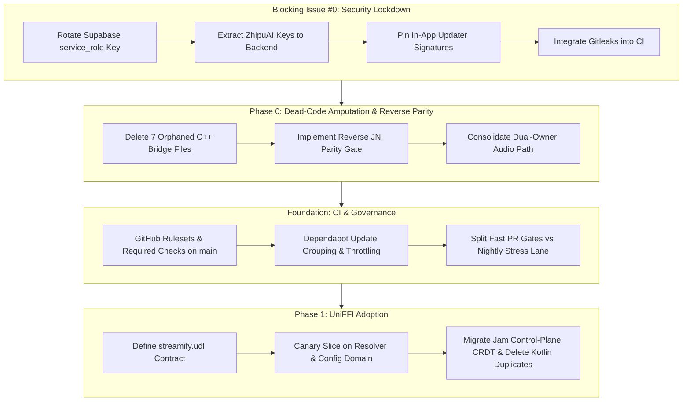

# Streamify A+ Tier Engineering & Architectural Master Plan
**Target Horizon:** October 26, 2026  
**Document ID:** `A_TIER_PLAN_26_10.MD`  
**Authors:** Senior Staff Systems Architect & Lead Maintainers  
**Status:** Approved for Execution (Consensus from RFC Discussion #83)

---

## 1. Executive Summary & Purpose

Streamify has built class-leading client systems: 120Hz liquid sheet physics, local P2P CRDT jam consensus, custom K-weighted audiophile DSP, and SIMD frame palette extraction. However, the codebase has suffered under a **Tri-lingual Frankenstein Architecture** (Kotlin + C++ + Rust) characterized by:
- Over 120 hand-rolled `Java_*` JNI exports vulnerable to uncaught panics and JVM process abortion (`SIGSEGV`).
- 7 dead C++ JNI bridge files (~7,000 LOC of compiled dead weight) completely disconnected from the Android app.
- Critical security vulnerabilities including committed `service_role` database administrator keys and plaintext third-party AI keys.
- CI instability caused by high-concurrency 32-peer mesh simulations racing on resource-constrained runners alongside uncoordinated Dependabot upgrade storms.

This plan details the surgical path to transform Streamify from a **B- liability** into a **hardened, maintainable, high-velocity A+ tier mobile systems repository**.

---

## 2. Core Architectural Principles (The Invariants)

1. **The Contract-First Law**: No raw, hand-rolled JNI control-plane symbols will ever be introduced again. All future native boundaries must be defined in a centralized, reviewable, diffable `.udl` contract using **UniFFI**.
2. **Hard Real-Time Audio Isolation**: The 10–20ms audio buffer render loop is strictly non-allocating, zero-copy, and lock-free. Real-time audio DSP bypasses UniFFI and GC-managed memory entirely, communicating directly with AAudio/Oboe NDK or a single pinned native frame hook.
3. **Data-Driven DSP Retention**: C++ NEON kernels will not be rewritten out of dogma. Existing DSP implementations stay as leaf libraries unless a candidate Rust implementation matches bit-exact output and demonstrates $\le 5\%$ latency variance on mid-tier ARM reference devices.
4. **Bi-directional Parity Enforcement**: CI must enforce both forward parity (`Kotlin -> Native`) and reverse parity (`Native -> Kotlin`). No uncalled native symbols may exist in shipped binaries.

---

## 3. Execution Roadmap

---

### Step 0: Blocking Security & Supply-Chain Hardening
* **Supabase Admin Key Remediation**: Rotate the exposed key at `app/build.gradle.kts:25` (`role: service_role`). Rebind client traffic strictly to an unprivileged anonymous key and route all administrative operations (`set_user_admin_role`, `terminate_jam_session_admin`) through authenticated Supabase Edge Functions.
* **C++ Secret Extraction**: Remove plaintext `ZHIPU_KEYS[]` from `native/jni/jni_bridge.cc:771-777` and proxy requests through a secure gateway.
* **In-App Updater Signature Pinning**: Disable debug-keystore release fallback in `build.gradle.kts:69-84` and enforce SHA-256 cert pinning on downloaded updates.
* **Gitleaks CI Gate**: Install automated static secret detection on all pull request and push workflows.

---

### Step 1: Phase 0 — Dead-Code Amputation & Reverse Parity
* **Amputate 7 Ghost Bridges**:
  - `native/jni/jni_bridge_native_dsp_engine.cc`
  - `native/jni/jni_bridge_harmonic_engine.cc`
  - `native/jni/jni_bridge_media_palette.cc`
  - `native/jni/jni_bridge_audio_remuxer.cc`
  - `native/jni/jni_bridge_agsl_glow.cc`
  - `native/src/jni_bridge_frame_palette.cpp`
  - `native/src/jni_bridge_audio_sinks.cpp`
* **Implement Reverse Parity CI Check**: Extend `scripts/jni_parity_check.py` to inspect all exported `Java_*` symbols and ensure they map to an active Kotlin `external fun` declaration in the application tree.
* **Single-Owner Audio Thread**: Unify the dual-library audio processing path where C++ and Rust currently interleave calls on the same real-time audio thread.

---

### Step 2: Foundation & Repository Governance
* **GitHub Rulesets on `main`**: Enable GitHub rulesets enforcing linear commit history, branch up-to-date requirements, and mandatory green status checks (`compile-check`, `rust-lint`, `build-and-compile`, and parity checks). Prohibit direct pushes to `main`.
* **Dependabot Grouping**: Refactor `.github/dependabot.yml` to group minor dependency updates and throttle automated PR creation.
* **Test Decoupling**: Separate deterministic fast unit tests (< 2 minutes) for PR verification from high-concurrency 32-node mesh chaos simulations, which are relocated to a dedicated nightly matrix (`0 0 * * *`).

---

### Step 3: Phase 1 — UniFFI Control Plane Migration
* **Interface Specification**: Establish `rust/src/streamify.udl` as the canonical boundary contract for all domain entities, errors, and asynchronous callbacks.
* **Canary Slice**: Pilot UniFFI compilation, packaging, and R8 rule validation on pure functions (resolver plumbing, deterministic candidate hashing).
* **CRDT Jam Migration**: Migrate Jam session state reconciliation and voting ops to UniFFI, allowing complete retirement of redundant Kotlin duplicate implementations using the established golden vector suite (`fixtures/jam_golden_vectors.json`).
