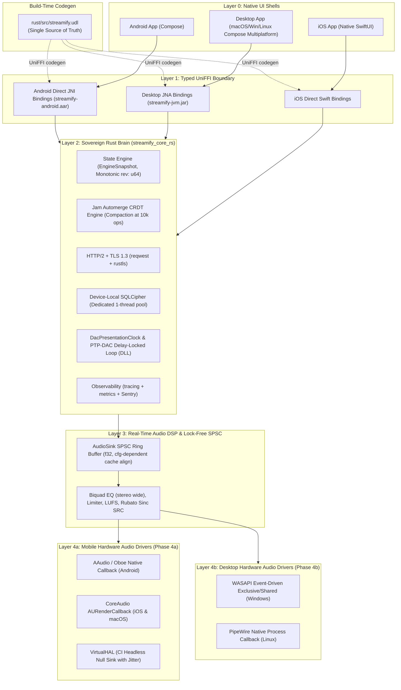

# Streamify Multiplatform Universal Core Architecture Master Plan
**Target Platforms:** Android, iOS/iPadOS, macOS, Windows, Linux  
**Document ID:** `MULTIPLATFORM_PLAN_27_10.MD`  
**Governing Consensus:** [RFC Discussion #104](https://github.com/meraxes89/streamify-apk/discussions/104#discussioncomment-19212616) & Architectural Review (`docs/nano/resp5.md`)  
**Authors:** Senior Staff Systems Architect & Core Maintainers  
**Status:** Approved for Execution  

---

## 1. Executive Summary & Purpose

Streamify has achieved an A+ hardened Android foundation: 100% linear git history, zero orphan JNI bridges, centralized UniFFI control-plane scaffolding, and sub-100MB release footprint. However, the existing architecture is constrained to Android:
- **Platform-Coupled Audio Plumbing**: Audio consumption is tied to Android AudioTrack/AAudio and Java AudioFocus governors.
- **UI Codebase Inelasticity**: UI state machines are tied directly to Jetpack Compose Android lifecycle rather than platform-agnostic presentation models.
- **Clock Domain Skew**: Monotonic wall-clock interpolation (`System.currentTimeMillis()`) causes drift and jitter across heterogeneous hardware clocks.
- **Lack of Multi-OS Portability**: Desktop (Windows/macOS/Linux) and Apple mobile (iOS) targets require separate native compilation targets, audio pull drivers, and OS-specific media command integration.

This master plan establishes the technical blueprint to transition Streamify into a **Universal Cross-Platform Audiophile Client** spanning **Android, iOS, macOS, Windows, and Linux** using a sovereign Rust core, unified UniFFI contracts, and decoupled native pull HAL adapters.

---

## 2. Core Architectural Invariants

1. **The Sovereign Rust Core Law**: 100% of non-UI logic (networking, state machines, Jam CRDT consensus, SQLite storage, and audio DSP) resides in `streamify_core_rs`. No state logic may be re-implemented in client UI shells.
2. **Dual Direct UniFFI Codegen (Target-Specific Binding Modes)**:
   - **Android**: UniFFI emits **direct JNI bindings** (`streamify-android.aar`). JNA is strictly prohibited on Android as it acts as an unnecessary second JNI layer adding ~800KB bloat and call-latency overhead.
   - **Desktop JVM (macOS, Windows, Linux)**: UniFFI emits **JNA bindings** (`streamify-jvm.jar`).
   - **iOS / iPadOS**: UniFFI emits **Swift bindings directly** for a native SwiftUI shell.
   - **"No Double-Bridge" Invariant on Apple**: No routing Swift through Kotlin/Native (`cinterop`) or Obj-C wrappers. This saves 10–20MB in binary size, cuts build times by 3–5×, provides first-class Apple tooling (LLDB), and eliminates foreign runtime dependencies.
3. **Hardware HAL as Clock Master (`DacPresentationClock`)**: The hardware DAC callback is the sole clock master. Playback position, seek confirmation, and visualization sync are strictly derived from hardware presentation timestamps:
   ```rust
   pub struct DacPresentationClock {
       pub dac_frame_position: u64, // hardware consumed counter
       pub sample_rate: u32,        // device DAC nominal rate
       pub monotonic_ns: u64,       // OS monotonic presentation timestamp
   }
   ```
   Zero wall-clock (`System.currentTimeMillis()`) interpolation in any UI shell. Acceptance criterion: `<5ms` error vs a loopback cable reference across each platform HAL.
4. **Push, Event-Driven Reactive State (No Polling)**: Control-plane UI loops (`LaunchedEffect`) must never poll `get_playback_state()`. The Rust core dispatches coalesced state snapshots via `EngineEventListener` with monotonic revisions (`rev: u64`) on a dedicated, non-real-time worker thread.
5. **Pure 32-Bit Float (`f32`) & Zero FFI on Audio Thread**: The real-time playback pump lives entirely in native space. Platform HAL callbacks pull samples directly from the lock-free SPSC ring buffer in IEEE 754 32-bit float without crossing FFI boundaries or converting prematurely to integer PCM.
6. **Canonical 48kHz Internal DSP & Single-Point Output SRC**:
   - Canonical internal rate: **48kHz `f32` stereo** in ring buffer and DSP. Producer side resamples all content (44.1k, 96k, 192k) to 48kHz using polyphase sinc (`rubato::SincFixedOut`).
   - Output SRC to device rate happens only at the last stage in the HAL callback.
   - Device rate change: Tear down and rebuild the stream (`EngineEvent::AudioDeviceChanged`).
   - Audiophile escape hatch: "Device-native rate" mode bypassing output SRC when content matches device rate.
7. **Lock-Free Consumer-Cooperative Flush Protocol**:
   - Producer writes `flush_generation.fetch_add(1, Relaxed)` and spins until `flush_ack_generation == flush_generation`.
   - Consumer callback checks generation, resets read cursor, and stores `flush_ack_generation`. Formally verified under `loom` tests.
8. **Panic Safety Across FFI**:
   - `panic = "abort"` in release profile + wrap every exported function in `std::panic::catch_unwind`, converting errors to `EngineError::Internal { message, backtrace }`.
9. **Bi-directional Media Command Flow with Debounce**:
   - Reverse control plane: `MediaCommandSource` trait and `Engine::on_media_command(cmd)`.
   - 50–150ms hardware debounce for rapid Bluetooth headset toggles.
10. **Device-Local Encrypted Storage**:
    - Rusqlite + SQLCipher keyed per-device from OS Keyring (Android KeyStore, iOS Keychain, Windows DPAPI, Linux Secret Service). Jam cloud sync exchanges CRDT ops over HTTPS, never syncing raw SQLite database files.

---

## 3. High-Level Systems Architecture



---

## 4. Multiplatform Phased Roadmap (Refined 2-Engineer Scope)

### Phase 3: Contract Freeze, SPSC Hardening, Panic Safety & Cargo Matrix
* **Contract Expansion (`streamify.udl`)**:
  - Expose `DacPresentationClock` struct: `dac_frame_position: u64`, `sample_rate: u32`, `monotonic_ns: u64`.
  - Expose `EngineEventListener` callback interface for non-blocking push dispatching.
  - Expose `MediaCommandSource` enum (`Play`, `Pause`, `TogglePlayPause`, `Next`, `Previous`, `Seek`, `SetVolume`, `Stop`) with 50–150ms debounce.
  - Expose structured, nested `EngineError` enum with `#[non_exhaustive]` (`Network`, `Audio`, `Storage`, `Crypto`, `Internal`).
  - Embed `contract_version: u32` for startup ABI verification.
* **Lock-Free AudioSink Hardening (`audio_sink_ringbuffer.h`)**:
  - Target-dependent cache line alignment: `alignas(128)` on macOS/iOS (Apple Silicon), `alignas(64)` on x86/Windows.
  - C++17 over-aligned dynamic allocation (`operator new[](..., std::align_val_t{CACHE_LINE})`) for Windows MSVC portability.
  - End-to-end `float*` storage preserving full 32-bit floating point dynamic range into pull drivers.
  - Generational flush protocol verified via `loom` concurrency tests.
* **Audio Resampling (SRC)**:
  - Integrate `rubato::SincFixedOut` polyphase sinc resampler on producer side targeting canonical 48kHz `f32`.
* **Cargo Workspace & Observability**:
  - Split outputs: JNI mode for Android target, JNA for desktop JVM, `staticlib` for iOS XCFramework.
  - Gate `jni` dependency strictly to `[target.'cfg(target_os = "android")'.dependencies]`.
  - Standardize on `reqwest` (HTTP/2 + TLS 1.3) + `tokio` (single `OnceLock<Runtime>`); gate experimental HTTP/3 behind feature flag.
  - Add `tracing` subscribers (android_logger, os_log, ETW, journald) + `metrics` + `sentry` crash telemetry.

---

### Phase 4a: Mobile First Parity (Android + iOS + VirtualHAL)
* **VirtualHAL CI Test Double**:
  - Deterministic in-memory null sink with simulated hardware DAC clock.
  - Simulates adversarial conditions: callback size variance (256/512/1024), timing jitter (±10%), injected underruns/overruns, and rate change events.
  - Runs headless on Linux, macOS, and Windows CI runners.
* **Mobile Native Pull HAL Adapters**:
  - **CoreAudio (iOS & macOS)**: `AURenderCallback` pulling `f32` frames directly from `AudioSink`.
  - **AAudio (Android)**: Native C++ `AAudioStream_dataCallback` pulling `f32` frames from `AudioSink`.
* **Golden-Vector Audio Verification**:
  - Cross-platform test suite verifying bit-exact DSP, LUFS normalizer, and EQ output at 48kHz across x86_64, aarch64, and Apple Silicon.
* **DacPresentationClock Acceptance**:
  - Verify `<5ms` latency estimation error on Android and iOS hardware.

---

### Phase 4b: Desktop HALs (Windows & Linux)
* **WASAPI (Windows)**:
  - Exclusive/shared event-driven client using `IAudioClient3` & `AvSetMmThreadCharacteristics("Pro Audio")`.
* **PipeWire (Linux)**:
  - Real-time `pw_stream` process callback with fallback to ALSA.
* **Desktop CI Size Budget**:
  - Establish CI size budget for packaged Desktop CMP apps (<250MB).

---

### Phase 5: Shell Assembly & OS Capability Adapters
* **Native iOS SwiftUI Shell**:
  - Swift package wrapping UniFFI bindings directly (zero Kotlin/Native double-bridge).
  - `IOSAudioSessionAdapter` handling `.playback` category, interruption notifications, route changes (`.oldDeviceUnavailable` pause), and AirPlay teardowns.
  - Integration with `MPRemoteCommandCenter` and `MPNowPlayingInfoCenter` (rate-limited to 1Hz).
* **Compose Multiplatform (CMP) Shell**:
  - Migrate common UI modules (`components`, `theme`, `viewmodels`) to `shared/src/commonMain`.
  - Desktop responsive shell: adaptive navigation rail, keyboard shortcuts, system tray minimization.
* **Platform Capability Adapters**:
  - Windows: System Media Transport Controls (SMTC) & DPAPI secure storage.
  - Linux: MPRIS D-Bus interface & Secret Service / FreeDesktop keyring.
  - Android: Media3 `MediaSession` & Android KeyStore.
* **Android Feature-Flag Cutover**:
  - Run new Rust audio pipeline behind `BuildConfig.USE_RUST_AUDIO`. 2-week dogfood period before deprecating legacy path.

---

### Phase 6: Post-v1 Hardening
* Audio process isolation on Desktop (shared-memory ring buffer + control-plane socket).
* Re-evaluate HTTP/3 QUIC connection migration under production telemetry.
* Jam security token hardening (Ed25519 signed join tokens, 100 ops/sec rate limiting, Automerge document compaction).

---

## 5. Engineer Responsibility Matrix (2 Engineers)

| Phase | Milestone | Engineer 1: Alpha (Rust / Native DSP / Audio HAL) | Engineer 2: Beta (Client Shells / Bridge / Adapters) |
| :--- | :--- | :--- | :--- |
| **Phase 3** | **Contract & Hardening** | • `streamify.udl` contract expansion (`DacPresentationClock`, `EngineError`, `contract_version`)<br/>• `audio_sink_ringbuffer.h` C++17 & Apple Silicon alignment<br/>• Generational flush protocol + `loom` tests<br/>• 48kHz Rubato Sinc SRC integration<br/>• Cargo build matrix (JNI Android / JNA Desktop) | • Implement `EngineEventListener` in `NativeEngineBackend`<br/>• Implement `MediaCommandSource` input handling<br/>• Panic capture verification (`EngineError::Internal`)<br/>• `tracing` + `sentry` client initialization<br/>• Compose `StateFlow` reactive bridge |
| **Phase 4a** | **Mobile Audio Parity** | • `VirtualHAL` adversarial simulation (jitter, underruns)<br/>• CoreAudio (`AURenderCallback`) pull driver<br/>• AAudio native `f32` callback integration<br/>• 48kHz golden-vector test verification | • VirtualHAL JVM headless test harness<br/>• Android feature flag scaffolding (`USE_RUST_AUDIO`)<br/>• DacPresentationClock UI progress test double |
| **Phase 4b** | **Desktop Audio** | • WASAPI event-driven driver (Windows)<br/>• PipeWire process callback driver (Linux) | • Desktop test suite execution on Windows & Linux CI<br/>• Desktop binary size budget tracker (<250MB) |
| **Phase 5** | **Shells & Ports** | • Capability port bindings (SMTC, MPRIS, RemoteCommand)<br/>• iOS XCFramework packaging automation | • iOS SwiftUI shell scaffold + `AVAudioSessionAdapter`<br/>• Desktop Compose Multiplatform responsive shell<br/>• Android cutover execution and legacy cleanup |
