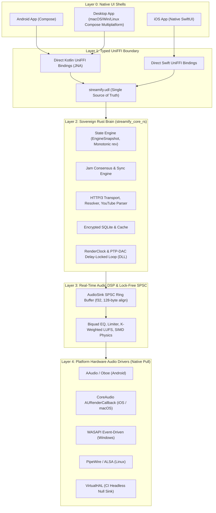

# Streamify Multiplatform Universal Core Architecture Master Plan
**Target Platforms:** Android, iOS/iPadOS, macOS, Windows, Linux  
**Document ID:** `MULTIPLATFORM_PLAN_27_10.MD`  
**Governing Consensus:** [RFC Discussion #104](https://github.com/meraxes89/streamify-apk/discussions/104#discussioncomment-19212616)  
**Authors:** Senior Staff Systems Architect & Core Maintainers  
**Status:** Approved for Execution  

---

## 1. Executive Summary & Purpose

Streamify has achieved an A+ hardened Android foundation: 100% linear git history, zero orphan JNI bridges, centralized UniFFI control-plane scaffolding, and sub-100MB release footprint. However, the existing architecture is constrained to Android:
- **Platform-Coupled Audio Plumbing**: Audio consumption is tied to Android AudioTrack/AAudio and Java AudioFocus governors.
- **UI Codebase Inelasticity**: UI state machines are tied directly to Jetpack Compose Android lifecycle rather than platform-agnostic presentation models.
- **Clock Domain Skew**: Monotonic wall-clock interpolation (`System.currentTimeMillis()`) causes drift and jitter across heterogeneous hardware clocks.
- **Lack of Multi-OS Portability**: Desktop (Windows/macOS/Linux) and Apple mobile (iOS) targets require separate native compilation targets, audio pull drivers, and OS-specific media command integration.

This master plan establishes the technical blueprint to transition Streamify into a **Universal Cross-Platform Audiophile Client** spanning **Android, iOS, macOS, Windows, and Linux** using a sovereign Rust core, unified UniFFI contracts, and decoupled native pull HAL adapters.

---

## 2. Core Architectural Invariants

1. **The Sovereign Rust Core Law**: 100% of non-UI logic (networking, state machines, Jam CRDT consensus, SQLite storage, and audio DSP) resides in `streamify_core_rs`. No state logic may be re-implemented in client UI shells.
2. **The "No Double-Bridge" Invariant on Apple**:
   - **Android & Desktop**: UniFFI generates Kotlin/JVM bindings directly for Compose Multiplatform.
   - **iOS / iPadOS**: UniFFI generates Swift bindings directly for a native SwiftUI shell.
   - **Forbidden**: Routing Swift through Kotlin/Native (`cinterop`) or Obj-C wrappers. This prevents dual garbage-collector memory contention and eliminates GC jitter on 120Hz ProMotion displays.
3. **Hardware HAL as Clock Master (`RenderClock`)**: The hardware DAC callback is the sole clock master. Playback position, seek confirmation, and visualization sync are strictly derived from hardware presentation timestamps (`frames_consumed`, `sample_rate`, `monotonic_ns`). Zero wall-clock interpolation.
4. **Push, Event-Driven Reactive State (No Polling)**: Control-plane UI loops (`LaunchedEffect`) must never poll `get_playback_state()`. The Rust core dispatches coalesced state snapshots via `EngineEventListener` with monotonic revisions (`rev: u64`) on a dedicated, non-real-time worker thread.
5. **Pure 32-Bit Float (`f32`) & Zero FFI on Audio Thread**: The real-time playback pump lives entirely in native space. Platform HAL callbacks pull samples directly from the lock-free SPSC ring buffer in IEEE 754 32-bit float without crossing FFI boundaries or converting prematurely to integer PCM.
6. **Lock-Free Consumer-Cooperative Flush**: Control threads request flushes via atomic flags (`flush_requested_`). The real-time audio consumer cooperatively resets cursors, preventing concurrency crashes and pointer underflows.
7. **Capability Ports over Monolithic Managers**: OS-specific features (media notifications, MPRIS, SMTC, keyrings) are decoupled through narrow Rust capability traits (`MediaCommandSink`, `MediaCapabilities`) rather than platform-locked monolithic managers.

---

## 3. High-Level Systems Architecture

---

## 4. Multiplatform Engineering Phased Roadmap

### Phase 3: Contract Freeze, SPSC Hardening & Build Matrix
* **Contract Expansion (`streamify.udl`)**:
  - Expose `RenderClock` struct: `frames_consumed: u64`, `sample_rate: u32`, `monotonic_ns: u64`.
  - Expose `EngineEventListener` callback interface for non-blocking push dispatching.
  - Expose `MediaCommandSink` and `MediaCapabilities` interfaces.
  - Formalize sealed typed error hierarchy (`[Throws=EngineError]`).
* **Lock-Free AudioSink Hardening (`audio_sink_ringbuffer.h`)**:
  - Apple Silicon 128-byte cache line alignment (`kCacheLineSize = 128`) on ARM64 macOS/iOS to prevent L1 false sharing.
  - C++17 over-aligned dynamic allocation (`operator new`) for Windows MSVC portability.
  - End-to-end `float*` storage preserving full 32-bit floating point dynamic range into the pull drivers.
* **Cargo Workspace & Cross-Compilation Matrix**:
  - Gate `jni` dependency strictly to `[target.'cfg(target_os = "android")'.dependencies]`.
  - Separate `cdylib` (Android/Linux/Windows) from `staticlib` (iOS XCFramework / macOS framework).
  - Unify network stack on `reqwest` + `tokio` + `rustls` (drop blocking `ureq`).

---

### Phase 4: Virtual HAL, Golden Vectors & Native Pull Adapters
* **VirtualHAL CI Test Double**:
  - Implement deterministic in-memory null sink with simulated hardware DAC clock.
  - Enables full headless integration testing across macOS, Linux, and Windows CI runners without physical audio hardware.
* **Golden-Vector Audio Verification**:
  - Build cross-platform audio test suite verifying identical bit-exact DSP, LUFS calculation, and EQ filter curves across x86_64, aarch64, and Apple Silicon.
* **Native Pull HAL Adapters**:
  - **CoreAudio (Apple iOS & macOS)**: `AURenderCallback` pulling `f32` frames directly from `AudioSink`.
  - **WASAPI (Windows)**: Exclusive/shared event-driven client using `IAudioClient3` & `AvSetMmThreadCharacteristics`.
  - **PipeWire (Linux)**: Real-time `pw_stream` process callback.
  - **AAudio (Android)**: Native C++ `AAudioStream_dataCallback`.

---

### Phase 5: Shell Assembly & OS Capability Adapters
* **Compose Multiplatform (CMP) Shell**:
  - Migrate common UI modules (`components`, `theme`, `viewmodels`) to `shared/src/commonMain`.
  - Desktop responsive shell: adaptive navigation rail, keyboard shortcuts, system tray minimization.
* **Native iOS SwiftUI Shell**:
  - Lightweight Swift package wrapping UniFFI bindings.
  - Integration with `AVAudioSession`, `MPRemoteCommandCenter`, and `MPNowPlayingInfoCenter`.
* **Platform Capability Adapters**:
  - Windows: System Media Transport Controls (SMTC) & DPAPI secure storage.
  - Linux: MPRIS D-Bus interface & Secret Service / FreeDesktop keyring.
  - Android: Media3 `MediaSession` & Android KeyStore.

---

## 5. Engineer Responsibility Matrix (2 Engineers)

| Engineer | Focus Area | Deliverables |
| :--- | :--- | :--- |
| **Engineer 1 (Alpha)** | **Rust Core, Native DSP, UniFFI & HAL Adapters** | • `streamify.udl` contract expansion • `audio_sink_ringbuffer.h` C++17/Apple Silicon alignment • `VirtualHAL` deterministic mock harness • Native CoreAudio, WASAPI, PipeWire, AAudio pull drivers • Cargo cross-platform compilation targets |
| **Engineer 2 (Beta)** | **Client Shells, Event Dispatchers & Capability Adapters** | • `NativeEngineBackend` push listener implementation • `RenderClock` progress tracking in UI • Compose Multiplatform common UI extraction • Platform capability adapters (Media3, SMTC, MPRIS) • Swift UI shell scaffold for iOS |
