# 🔊 PLAYBACK DATA PLANE — THE SOVEREIGN DRIVETRAIN — Engineering Documentation

> **The audio rendering pipeline that makes the Sovereign Core actually play: producer → `AudioSink` write edge → platform HAL.**
> One engine, every speaker (AHEAD.md Pillar 1 — "MAKE IT PLAY"). This RFC is the A1 deliverable for workstream **WS-A (ENG-1 "Drivetrain")**:
> it specifies the data-plane architecture, the Rust-side `AudioSink` trait aligned with the frozen C++ ABI, the transport semantics that
> shipped with it (A2), the panic-policy decision record (A6), and — as of issue #151 — the SHIPPED producer pipeline (A3), the UniFFI
> surface (A4) and the live-audio self-test harness (A5).

| Subsystem Spec | Details |
|---|---|
| **Status** | RFC **active** (A1). Transport slice **shipped** (A2, issue #148). Panic policy **reconciled** (A6, issue #148). Producer + sink edge + UniFFI surface + self-test harness **shipped** (A3/A4/A5, issue #151). Every claim below is marked `shipped` or `planned` against the tree. |
| **Owner** | ENG-1 "Drivetrain" (engine side); ENG-3 owns the JNI/HAL mounting brackets (C1/C5), ENG-2 owns Apple integration (B4) |
| **Control plane (shipped)** | `rust/crates/streamify-contract/src/contract.rs` — `StreamifyEngine` state machine, `MediaCommand`, debounce, seqlock snapshots |
| **Transport (shipped, A2)** | `apply_media_command` Seek/Next/Previous over the staged typed queue + position target |
| **Canonical geometry** | 48 kHz interleaved `f32` stereo (`CANONICAL_RATE_HZ`, `rust/crates/streamify-audio/src/audio_src.rs`) |
| **Resampler** | `rubato::SincFixedOut<f32>` behind `CanonicalSrc` (single-producer-thread ownership) |
| **Loudness** | BS.1770-4 `LufsAnalyzer`/`LufsNormalizer`, golden-pinned (`rust/crates/streamify-audio/src/lufs.rs`) — designated canonical implementation (C8) |
| **Frozen sink ABI** | `native/include/streamify_audio_sinks.h` — 7 JNI symbols, 96-byte DirectByteBuffer stats layout, opaque int64 handles |
| **Clock truth** | `DacPresentationClock` (MP-DEC-03): the HAL callback is the sole clock master; zero wall-clock interpolation |

---

## Table of Contents

1. [Design Philosophy — One Engine, Every Speaker](#1-design-philosophy--one-engine-every-speaker)
2. [The Gap This Closes](#2-the-gap-this-closes)
3. [Architecture — Four Planes](#3-architecture--four-planes)
4. [The Transport Layer (A2 — shipped)](#4-the-transport-layer-a2--shipped)
5. [The Stream Producer (A3 — shipped)](#5-the-stream-producer-a3--shipped)
6. [The `AudioSink` Write Edge (frozen ABI alignment)](#6-the-audiosink-write-edge-frozen-abi-alignment)
7. [Platform HAL Bindings (ownership map)](#7-platform-hal-bindings-ownership-map)
8. [Panic Policy Decision Record (A6 — shipped)](#8-panic-policy-decision-record-a6--shipped)
9. [The UniFFI Surface (A4 — shipped)](#9-the-uniffi-surface-a4--shipped)
10. [Live-Audio Self-Test Harness (A5 — shipped)](#10-live-audio-self-test-harness-a5--shipped)
11. [Metrics & SLOs](#11-metrics--slos)
12. [Task Status & Sequencing](#12-task-status--sequencing)
13. [Evidence Index](#13-evidence-index)

---

## 1. Design Philosophy — One Engine, Every Speaker

The Sovereign Core thesis put all business logic in Rust and bound platforms to it directly. The multiplatform migration proved the
*architecture*; the drivetrain's job is to prove the *promise*: **one engine, every speaker** — the same Rust pipeline renders on Android,
desktop (WASAPI/PipeWire/ALSA) and Apple (CoreAudio), with the platform contributing only the final HAL adapter.

Three rules govern every decision below:

| Rule | Consequence |
|---|---|
| **Correctness over velocity, at frozen ABIs** (PHILOSOPHY non-negotiable #3) | The sink ABI is already frozen in `streamify_audio_sinks.h`; the Rust trait must MIRROR it, not invent a parallel one. Any change goes through an additive, versioned review (§6.3). |
| **The HAL is the clock master** (MP-DEC-03) | No component ever interpolates playback position from a wall clock. Position truth flows from `DacPresentationClock` samples; the engine records, it does not smooth. |
| **Zero allocation on the audio edge** (AMP-10 discipline) | The write edge is zero-allocation, zero-lock (the C++ ring's discipline); the producer stages into pre-allocated buffers; `AllocGuard`-style proofs extend to the new path. |

**Non-goals** (inherited from AHEAD §8): no on-device ML runtimes, no server-side taste computation, no new platforms before Waves 1–3 close.

---

## 2. The Gap This Closes

Verified against the tree at `09a4e20b` (TRUTH-02), every claim in AHEAD.md §1.2 hard truth 1 held:

- `apply_media_command` was a state machine only: `Seek | Next | Previous` were literal no-ops (`contract.rs`, the pre-#148 arm read
  *"effects deferred to the queue engine phase"*). **The transport slice of this gap is now closed** (§4).
- The WASAPI/PipeWire/ALSA/CoreAudio C facades (`native/audio/wasapi_pull_adapter.cpp`, `pipewire_driver.cpp`,
  `coreaudio_pull_adapter.cpp`) had **zero production callers** — they compiled nowhere that links them into a product. The CoreAudio
  facade's caller **landed with WS-B B4** (`PlaybackViewModel` → `CoreAudioRenderCore.startRustRing` →
  `streamify_coreaudio_start_rust_ring`, pulling through the ring's frozen C ABI); WASAPI/PipeWire/ALSA close with C5 against the §6 edge.
- The JNI sink bridge `native/src/jni_bridge_audio_sinks.cpp` **does not exist** (the header, wire layout, registry and serializer do;
  the app-side seam `RustAudioSinkJni.kt` is waiting on it, declarations quarantined in the debug-only dogfood source set). Closes
  with C1 (ENG-3).
- No decoder exists anywhere in the workspace (`Cargo.lock` carries no Opus/AAC decoder): the producer's decode stage is a **new
  dependency decision**, specified in §5.2 with the mandated rationale.

The success metric is not "code merged" but **hours of audible playback per platform per day on the Rust engine** (AHEAD §5).

---

## 3. Architecture — Four Planes

```mermaid
graph TB
    subgraph CONTROL["CONTROL PLANE (shipped)"]
        MC["MediaCommand (MP-C03)<br/>debounced 50-150 ms"]
        SNAP["EngineSnapshot seqlock push<br/>(MP-C02, frozen shape)"]
        CLOCK["record_dac_clock (MP-C01)<br/>DacPresentationClock"]
    end

    subgraph TRANSPORT["TRANSPORT (A2 — shipped, issue #148)"]
        CURSOR["queue cursor + position target<br/>Seek / Next / Previous"]
    end

    subgraph PRODUCER["PRODUCER (A3 — planned)"]
        FETCH["HTTP range fetch<br/>(downloader.rs resume discipline)"]
        DECODE["Opus / AAC decode<br/>(§5.2 — new dep decision)"]
        RESAMPLE["CanonicalSrc<br/>rubato SincFixedOut → 48 kHz f32"]
        LUFS["LufsNormalizer<br/>BS.1770-4 chain"]
    end

    subgraph SINKEDGE["SINK WRITE EDGE (frozen ABI)"]
        RING["audio_sink_ringbuffer.h<br/>SPSC, cacheline-aligned,<br/>cooperative RequestFlush"]
        STATS["96-byte stats wire<br/>(magic 0x51AB0001)"]
    end

    subgraph HAL["PLATFORM HAL (C1 / C5 / B4)"]
        AAUDIO["Android: jni_bridge_audio_sinks.cpp<br/>→ AAudio (C1, ENG-3)"]
        WASAPI["Windows: wasapi_pull_adapter<br/>(C5)"]
        PIPEWIRE["Linux: pipewire_driver / ALSA<br/>(C5)"]
        COREAUDIO["Apple: coreaudio_pull_adapter<br/>(B4, ENG-2)"]
    end

    MC --> CURSOR
    CURSOR -->|"play intent + position target"| FETCH
    FETCH --> DECODE --> RESAMPLE --> LUFS --> RING
    RING --> AAUDIO & WASAPI & PIPEWIRE & COREAUDIO
    AAUDIO & WASAPI & PIPEWIRE & COREAUDIO -->|"DAC clock samples"| CLOCK
    CLOCK --> SNAP
    RING --> STATS
```



The planes are deliberately decoupled at the points where ownership changes:

- **Control → transport**: the debounced `MediaCommand` stream (shipped).
- **Transport → producer**: the *play intent* — current queue row + position target (the transport emits intents into the producer
  on every track change and seek since A3 shipped: rows carrying a resolved stream URL drive the data plane automatically).
- **Producer → sink**: f32 PCM at the canonical geometry, written through the frozen write edge (§6).
- **Sink → HAL → engine**: DAC presentation-clock samples flow back through `record_dac_clock` and are republished in every snapshot;
  this is the **rendered-position truth** the transport's target is reconciled against (§4.3).

---

## 4. The Transport Layer (A2 — shipped)

Shipped in issue #148. The contract tests that pin it live in
`rust/crates/streamify-contract/tests/test_uniffi_contract.rs` (round-trips + revision bumps).

### 4.1 State

| State | Home | Type | Written by |
|---|---|---|---|
| Staged rows | `EngineShared.queue` (`Mutex<QueueLane>`) | `Vec<QueuedTrack>` | `enqueue_track` / `clear_queue` |
| Transport cursor | `QueueLane.cursor` (same lock as the rows) | `Option<usize>` | `Next` / `Previous` / `clear_queue` |
| Position target | `EngineShared.position_ms` (atomic; written under the queue lock by transport mutations) | `u64` ms | `Seek` / track changes / `clear_queue` |

The cursor lives **inside the same lock as the rows** so a cursor move and the row page it indexes are always observed as one
consistent generation. The position target is a plain atomic (lock-free reads) but is written while holding the queue lock, so a seek
racing a track change can never leak a stale target across rows.

### 4.2 Command semantics

| Command | Behavior |
|---|---|
| `Seek { position_ms }` | Re-anchors the position target within the **current row**, clamped to the row's `duration_ms` when it carries one (> 0). A row with `duration_ms == 0` (duration unknown — streams resolve late) clamps nothing. With **no row selected** it is an acknowledged no-op: there is nothing to seek within. |
| `Next` | Moves the cursor forward with **wrap-around** at the tail (mirroring the legacy `get_next_track` circular loopback, `queue_engine.rs`), selects the queue **head** from an unselected state, resets the position target to 0. Empty queue: acknowledged no-op. |
| `Previous` | Mirror of `Next`: wraps at the head to the last row; selects the head from an unselected state; resets the position target. Empty queue: acknowledged no-op. |

Invariants:

- **The lifecycle is never touched by the transport.** A `Next` while `Paused` stays paused with a new current row; `Play`/`Pause`/
  `TogglePlayPause`/`Stop` keep their Phase-3 semantics. Rendering the *audible* effect of these commands is the producer's job (A3).
- **Every applied command bumps the snapshot revision** (the MP-C03 acknowledgment contract — `on_media_command` notifies); a
  debounced duplicate publishes nothing. The pushed `EngineSnapshot`'s visible fields do not change for transport commands (the shape
  is frozen; the queue/transport are read-after-action typed surfaces), so the bump is the acknowledgment signal itself.
- **`clear_queue` resets the whole transport** (cursor → none, position → 0) in the same lock acquisition that drops the rows — a
  dangling cursor would be a lie every later command would inherit.
- **Debounce identity is the raw payload** (`media_command_key`, `streamify-core/src/media.rs`): two identical seeks inside the window
  collapse; different payloads scrub freely.

### 4.3 Position truth: target vs rendered

`get_playback_position_ms()` (Rust-side surface; UDL exposure lands with A4) returns the **control-plane target** — the value the last
accepted `Seek` stored. The **rendered** position is a different quantity with a different source of truth: once the producer drives a
sink, the audible position derives from `DacPresentationClock` samples (frames ÷ rate) ingested by `record_dac_clock` and republished
in every pushed snapshot. The engine never interpolates position from a wall clock (MP-DEC-03). The producer reconciles target ↔ DAC
clock whenever it re-anchors after a seek (§5.4).

### 4.4 Relationship to the legacy lanes

Two pre-existing transport-adjacent lanes remain, deliberately untouched by A2:

- The **raw C-ABI queue picker** (`get_next_track` in `queue_engine.rs`): SQLite-backed linear/shuffle next-track selection for the
  legacy Android lane. A2's typed transport preserves its circular-loopback semantics on the typed queue; the picker stays until the
  MP-CUT02 cutover deletes the legacy path (C2).
- The **JNI seek guard** (`seek_guard.rs`: `submit_seek_request` / `consume_pending_seek`): the seekbar-drag debounce for the ExoPlayer
  lane (sub-5 ns, lock-free). The typed transport's 50–150 ms command debounce (MP-C03) serves the *hardware* reverse plane, not
  seekbar dragging; the two coexist until the producer lane replaces the ExoPlayer consumer (C2/MP-CUT02).

---

## 5. The Stream Producer (A3 — shipped)

**Shipped in issue #151** — the `streamify-playback` crate. The producer turns a play intent into canonical-geometry PCM at the sink
write edge, on a dedicated producer thread that never touches the audio callback. File map: `rust/crates/streamify-playback/src/`
(`fetch.rs` the range abstraction, `decode.rs` the `TrackDecoder` trait + symphonia backend, `producer.rs` the thread,
`sink.rs` the SPSC write edge, `frame_buf.rs` the pre-allocated staging).

### 5.1 Stage pipeline

1. **Fetch** — HTTP range requests against the resolved stream URL, reusing the segmented-range + SHA-256 verification discipline of
   `rust/crates/streamify-resolver/src/downloader.rs` (`download_stream_to_file`, `verify_file_integrity`). Range windows are chosen
   so the ring's high watermark stays ahead of the HAL's consumption by the buffering budget while never exceeding it by more than
   one segment (memory discipline on mobile).
2. **Decode** — see §5.2.
3. **Resample** — `CanonicalSrc` (`audio_src.rs`): `rubato::SincFixedOut<f32>`, any input rate in
   `[SRC_MIN_INPUT_RATE_HZ, SRC_MAX_INPUT_RATE_HZ]` → 48 kHz interleaved f32 stereo. One `CanonicalSrc` instance per producer
   session, owned by the producer thread only (the crate's documented threading contract).
4. **Loudness** — the BS.1770-4 chain (`lufs.rs`): `LufsAnalyzer` for measurement, `LufsNormalizer` for the target gain. Rust is the
   **canonical** LUFS implementation (C8 designates it so; the C++ `LufsNormalizer.cc` folds behind UniFFI or gets pinned to Rust
   golden vectors).
5. **Write edge** — staged PCM writes into the sink ring (§6), never allocating on the write path: all staging buffers are allocated
   at session start and reused; the write edge is a `memcpy`-shaped commit under the SPSC protocol.

### 5.2 Decode — the dependency decision

The workspace had **no decoder before issue #151**. **Shipped decision: `symphonia 0.6`** with the `aac` + `isomp4` + `ogg` + `pcm` +
`wav` feature flags — NOT the RFC-time candidate shape: the audit found **symphonia ships no Opus decoder in any released version**
(0.5.x and 0.6.x carry `ogg` as a *container* only; upstream issue pdeljanov/Symphonia#8, "work not started"). The RFC's own fallback
clause therefore applies: the codec-agnostic `TrackDecoder` trait (§5.3) is the boundary, AAC ships now (the resolver's documented
format ordering already prioritizes m4a/AAC over webm/opus rows), and Opus remains reversible (no production-grade pure-Rust Opus
decoder exists; a libopus binding would violate the pure-Rust profile). License: MPL-2.0 (supply-chain sanity check in the PR).
Per CONTRIBUTING.md ("new dependencies without a documented rationale in the PR description" → not merged), the A3 PR carries:

- the rationale (pure-Rust, decode-only, no ML/runtime baggage, maintained),
- the attack-surface note (untrusted container parsing — the input is a resolved CDN stream, i.e. hostile-media-adjacent; the
  existing `audio_sink_fuzz_harness` lane extends to decode once it exists, per C7),
- the vendoring/license check (PHILOSOPHY supply-chain discipline).

If the dependency review rejects the candidate, the fallback is a hand-rolled, fuzz-first Opus decoder behind the same trait — slower
to land, zero new supply-chain surface. The trait boundary (§5.3) is fixed either way so the decision is reversible.

### 5.3 The decode trait (shipped shape)

```rust,ignore
/// A3 (shipped): one decode session. Implemented by the Symphonia
/// backend and the hermetic fixture path the self-test harness (A5)
/// drives — the §5.2 decision stays reversible.
trait TrackDecoder: Send {
    /// Feed one byte range; append every input-geometry frame it
    /// completes. A frontier hit (more input needed mid-packet) is a
    /// checkpoint, not an error.
    fn push_range(&mut self, bytes: &[u8], out: &mut FrameBuf) -> Result<(), EngineError>;
    /// Signal source exhaustion; pump the tail.
    fn finish(&mut self, out: &mut FrameBuf) -> Result<(), EngineError>;
    fn is_eos(&self) -> bool;
    /// None until the container probe completes (partial headers).
    fn geometry(&self) -> Option<DecoderGeometry>;
}
```

The `FrameBuf` is a pre-allocated, reused staging buffer — allocation happens at session construction, never on the audio edge.

**The incremental-feed checkpoint protocol** (the non-obvious half of the backend): symphonia is a pull parser, so a fed-range frontier
hit surfaces as `IoError(UnexpectedEof)` mid-packet. The session then rewinds — `into_inner` → seek 0 → re-probe from the accumulated
buffer → `FormatReader::seek` to the frames already emitted — and continues exactly where it left off once more input arrives.
`chunked_feed_matches_whole_file_decode` (streamify-playback's decode suite) pins chunked feeds bit-identical to whole-file decodes
at three chunk sizes across both fixtures.

### 5.4 Cancellation and skip-under-load

Track skip is the hostile path (AHEAD A3 AC: 100 rapid skips, no leak, no underrun). Design:

- The transport's cursor move (§4.2) and `play_track` are the skip signals; the producer observes them between stage commits and
  aborts in-flight fetches (range requests are idempotent and simply abandoned), drops the decoder session, and re-stages at the new
  row's position target. **Shipped**: urgent commands (`Play`/`Stop`/`Shutdown`) interrupt at stage boundaries and inside write-edge
  park retries; benign commands (`Park`/`Resume`) flip the feeding gate without interrupting the in-flight chunk (the unwritten
  staging tail survives a pause — a pause never punches a hole in the audio).
- Abandonment is **cooperative at stage boundaries** — never a blocking cancel from the audio thread. The ring's cooperative
  `RequestFlush` (AMP-10) is the sink-side half: safe while the audio callback is live; the consumer thread performs the cursor
  reset on its next read.
- Re-anchoring after a seek: the producer discards down to the frame boundary at `position_ms`, then reconciles its emitted-frame
  count against the DAC presentation clock (the rendered truth, §4.3) so the UI's position converges to the hardware, not to a
  counter.

### 5.5 Acceptance gates (from AHEAD A3) — all green

- Golden-vector extension: the decode → resample → LUFS path is pinned against the checked-in fixtures
  (`fixtures/audio/playback_selftest_440hz_{48k,44k1}.wav`, generated by `scripts/generate_playback_fixtures.py`): exact frame
  counts, the 440 Hz dominant bin through an FFT, bit-identical chunked-vs-whole-file decoding.
- Skip-under-load stress: 100 rapid skips — zero leaks (deterministic join-based teardown), zero skip-attributable underruns
  (`live_audio_selftest_skip_under_load_100_intents` + `test_producer.rs::skip_under_load_100_rapid_intents_stay_clean`).
- Zero allocation on the audio edge: the write/read/flush/stats paths carry a counting-allocator proof
  (`test_ring.rs::write_edge_is_zero_allocation`), mirroring the RT discipline already proven in `streamify-audio`.

---

## 6. The `AudioSink` Write Edge (frozen ABI alignment)

### 6.1 What is already frozen (do not invent a parallel ABI)

`native/include/streamify_audio_sinks.h` specifies the complete sink contract the JNI bridge (`jni_bridge_audio_sinks.cpp`, C1) will
export — and the Rust side must mirror it, not replace it:

- **7 frozen JNI symbols** (six Phase-4a entrypoints + the additive MP-HAL05 f32 pull edge), matching the app-side seam
  (`app/src/main/java/com/streamify/app/media/audio/RustAudioSinkJni.kt`):
  `nativeCreateSink`, `nativeWriteFloat`, `nativeReadDirect`, `nativeGetStats`, `nativeFlush`, `nativeDestroy`,
  `nativeReadFramesF32`.
- **Opaque int64 handles** from a mutex-guarded registry — never raw pointers; stale/destroyed handles resolve to null, never a
  use-after-free (registry: `SinkRegistry` in the same header).
- **96-byte DirectByteBuffer stats wire** (little-endian, magic `0x51AB0001`): capacity, in/out rates and channels, fullness,
  frames written/read, underrun/overrun counters, watermarks, fill percent, estimated latency, monotonic sequence.
- **The SPSC ring** (`audio_sink_ringbuffer.h`): cacheline-aligned, generational flush via cooperative `RequestFlush`
  (release-store request / consumer acquire-exchange / tail-forward reset) — the exact protocol the Rust-side mirror in
  `test_uniffi_contract.rs` already pins.

### 6.2 The Rust-side trait (shipped, issue #151 — `streamify-playback/src/sink.rs`)

```rust,ignore
/// The Rust-side mirror of the frozen sink contract (§6.1). The C++
/// registry + JNI bridge and the desktop/Apple shims (C5/B4) implement
/// the same shape on their side of the edge; this trait is what the
/// producer writes into and what A5's VirtualHAL double impersonates.
trait AudioSink {
    /// Write interleaved canonical-geometry f32 frames. Returns frames
    /// accepted; a short write means the ring is at the high watermark
    /// (the producer parks — never blocks the audio callback).
    fn write_float(&mut self, frames: &[f32]) -> Result<usize, EngineError>;
    /// Cooperative flush (AMP-10): safe while the consumer is live.
    fn request_flush(&mut self) -> Result<(), EngineError>;
    /// Estimated output latency [ms] from the sink's own accounting
    /// (mirrors the +84 f32 wire field).
    fn estimated_latency_ms(&self) -> f32;
    /// Telemetry snapshot (mirrors the 96-byte wire, one struct).
    fn stats(&self) -> SinkStats;
}
```

Alignment rules: field-for-field parity with the wire layout (the `SinkStats` struct is the Rust image of the 96-byte buffer);
semantics-for-semantics parity with the cooperative flush protocol; the trait is `Send` but the sink instance is owned by exactly one
writer (SPSC by construction).

### 6.3 Frozen-ABI review (A1 sign-off)

- The Rust trait adds **no wire surface**: it maps onto the already-frozen C++ ABI. Any future divergence (e.g. a new stats field)
  goes through an additive layout-version bump mirroring the wire's `layout magic` + `layout bytes` discipline — never a silent
  reinterpretation.
- `CONTRACT_VERSION` (MP-C05) was untouched by A2/A6; the A4 UDL additions (`attach_sink`, `detach_sink`, `play_track`,
  `buffer_progress`) bumped it **additively to v2** in issue #151, as specified — a breaking bump would violate the freeze.
- ABI review sign-off for this RFC: ENG-1 (author), ENG-3 (C1 consumer of the edge — the header's own contract is unchanged, only
  mirrored). Recorded here as the A1 acceptance criterion.

---

## 7. Platform HAL Bindings (ownership map)

| Platform | Mounting bracket | Owner | Status |
|---|---|---|---|
| Android | `jni_bridge_audio_sinks.cpp` over the frozen 7 symbols; AAudio consumption; dogfood via `RustAudioDogfoodPanel` | ENG-3 (C1/C2) | header + app seam shipped; bridge not written |
| Windows | `wasapi_pull_adapter.cpp` facade (`streamify_wasapi_start`) called from the engine lane | ENG-3 (C5) | facade compiles nowhere (no WIN32 CMake lane — C4 adds it) |
| Linux | `pipewire_driver.cpp` / ALSA null-PCM CI lane | ENG-3 (C5) | facade has no production caller |
| Apple | `coreaudio_pull_adapter.cpp` + `CoreAudioRenderCore` + `IOSAudioSessionAdapter` | ENG-2 (B4) | **landed (WS-B)**: `PlaybackViewModel` mounts the render core; the pull edge is the abstract `RenderFrameSource`; `streamify_coreaudio_start_rust_ring` pulls from the Rust ring's frozen C ABI (`ring_export.rs`); audible-on-device proof pending |

The Rust side of every bracket is the same §6.2 trait — that is the entire point of the drivetrain: platform teams mount brackets,
not pipelines.

---

## 8. Panic Policy Decision Record (A6 — shipped)

**Decision: keep `panic = "abort"` for shipped release artifacts.** Shipped in issue #148 with the contract tests in
`rust/crates/streamify-contract/tests/test_panic_policy.rs` and the executable probe
`rust/crates/streamify-contract/src/bin/panic_probe.rs`.

### 8.1 Per-profile `ffi_shield` semantics

| Profile | Panic strategy | `ffi_shield` behavior | Verified by |
|---|---|---|---|
| `dev` / `test` (unwind) | unwind | **Active**: catches, marshals to `EngineError::Internal` (message + backtrace); the panic never crosses the boundary | `shield_marshals_panics_under_unwind_configurations` runs the probe (exit 0, `SHIELD_MARSHALED_PANIC`) |
| `release` (shipped artifacts) | **abort** (pinned in `rust/Cargo.toml [profile.release]`) | **Inert by design**: the panic terminates the process at the panic site; the fault routes through the platform crash reporter (Kotlin/ART, Swift, JVM desktop shell) instead of unwinding into it | `release_profile_pins_panic_abort_for_shipped_artifacts` pins the profile; the probe's `cfg(panic = "abort")` leg makes the behavior compile-time-unfalsifiable; local recipe: build the probe `--release`, run, expect SIGABRT |
| Downstream rlib consumers overriding the strategy | unwind | Active (the shield is the specified contract for every unwind configuration) | the probe built with any unwind override takes the marshaling leg |

### 8.2 Why keep abort (and what would reverse it)

The abort policy is an approved consensus (MP-C06/MP-C07, master plan invariant 8): a panic in a shipped library must never unwind
into the host process, and abort-fail-fast routes the fault through the platform crash reporter. Reversing it in this PR would have
changed shipped crash semantics for every artifact while the RFC that governs them was landing in the same commit — exactly the kind
of silent drift the truth program exists to prevent.

Reversal triggers (any of these reopens the decision, in a dedicated PR): (a) a crash-reporter backbone (G6) that requires
pre-abort marshaling, (b) a host platform whose crash reporter cannot attribute aborts to the engine, (c) a measured cost of the
abort tables that outweighs the fail-fast guarantee. The alternative AHEAD named — gating abort to non-host targets via per-lane
`RUSTFLAGS` — remains the documented fallback; it was not taken now because it would touch every artifact build lane (Gradle,
cargo-ndk, xcframework script, release workflow) in a PR whose purpose is the contract, not the churn.

### 8.3 The probe

`src/bin/panic_probe.rs` drives one deliberate panic through `panic_shield_self_test()` — the same shield path every UniFFI
trampoline specifies — and splits its legs at compile time via `cfg(panic = "...")` (the same flag the shield itself compiles
under, so the probe cannot drift from the configuration it witnesses). The unwind leg prints `SHIELD_MARSHALED_PANIC` and exits 0;
the abort leg never returns (SIGABRT). The abort leg's runtime proof is a documented local/nightly recipe (§8.1) — wiring it into
the nightly matrix belongs with the C3/C7 nightly work (ENG-3's lane), not this contract PR.

---

## 9. The UniFFI Surface (A4 — shipped)

**Shipped in issue #151.** The UDL delta that landed (additive; `CONTRACT_VERSION` 1 → 2 recorded per the version discipline):

* `dictionary BufferProgress` — the one-shot progress read: `buffered_ms`, `fill_ratio`, `underrun_events`, `overrun_events`,
  `target_position_ms` (A2's position target), `rendered_position_ms` (DAC-clock-derived, never wall-clock), `track_id?`,
  `producer_live`, `eos`.
* `void attach_sink(u32 capacity_frames)` — build the canonical SPSC ring + spawn the producer thread (replace semantics when live).
* `void detach_sink()` — idempotent, deterministic join.
* `void play_track(string track_id)` — select the staged row, reset the target, drive `Playing`, emit the intent (the skip path).
* `BufferProgress buffer_progress()` — the typed read.

`buffer_progress` events ride the EXISTING event dispatcher thread (MP-C02 discipline: the producer's stage commits update the
engine telemetry atomics and wake the coalesced push — no new thread, never the audio thread). The Rust-side hooks beyond the UDL:
`playback_ring()` (the consumer handle the C1/C5 brackets mount against) and `set_range_fetcher()` (the hermetic test seam).

Bindings regeneration procedure (the CI drift check enforces it on every PR): `UNIFFI_REGENERATE=1` via Gradle, or the exact
command from the clippy job — `cargo run --bin uniffi-bindgen -- generate rust/crates/streamify-contract/src/streamify.udl
--language kotlin --out-dir <tmp> --config rust/crates/streamify-contract/uniffi.toml` (plus the 0.28.3 `message → errorMessage`
codegen shim), diffed against `shared/src/desktopMain/kotlin/uniffi/streamify/streamify.kt`; the iOS lane regenerates Swift through
`scripts/build_ios_xcframework.sh`. A2/A6 deliberately added **zero** UDL surface — the transport getters (`get_current_queue_item`,
`get_playback_position_ms`) are Rust-side contract surfaces the A4 delta will expose, so the frozen bindings stayed drift-free in
this PR.

---

## 10. Live-Audio Self-Test Harness (A5 — shipped)

**Shipped in issue #151** — `rust/crates/streamify-contract/tests/test_live_audio_selftest.rs`, green in CI on every PR touching
`rust/**`. The harness proves the full chain hermetically: `play_track` → producer → sink → **measurable PCM**, with the
`virtual_hal.rs` adversarial double (`AdversarialModes::TIMING_JITTER`, 15 % fire-time jitter, a 1 ms reported-timestamp grid)
standing in for the DAC and a `LossyFixtureFetcher` scripting truncated ranges, transient failures and artificial delay into the
network stage.

- **"Engine says 440":** the 1.5 s 440 Hz fixture (canonical geometry) plays end to end; the harness FFTs the consumed left channel
  (Hann-windowed 65 536-point radix-2, hermetic — no DSP dependency) and asserts the dominant bin is 440 Hz ± 2, the underrun
  counters are ZERO on both the ring's and the VirtualHAL's accounting, every one of the 72 000 frames is consumed, the rendered
  position tracks the consumed frames (same clock domain), the span is wall-plausible (the only sanctioned wall-clock use), and the
  LUFS-normalized output amplitude is sane.
- **The resample leg:** the same gate through the 44.1 kHz fixture — the dominant bin is still 440 Hz at the canonical rate after
  the rubato leg, proving decode → resample → LUFS end to end.
- **Skip-under-load:** 100 rapid `play_track` intents while the HAL consumes — no deadlock, deterministic teardown (the leak
  proof), and the FINAL intent still passes the 440 Hz gate.
- EOS-aware quantum handling: the final partial quantum (72 000 % 512 frames) is the stream's tail, not starvation — the HAL model
  is asked for exactly what remains once the session is at EOS.
- Reusable as the desktop smoke test (`DesktopJnaEngineSmokeTest` extension, C5's AC) and as the Android dogfood panel's telemetry
  source.
- CI gate: `cargo test -p streamify-contract live_audio_selftest` — the demo-or-it-didn't-happen rule for Wave 2's "AUDIBLE" gate.

---

## 11. Metrics & SLOs

From AHEAD §5 (the drivetrain's slice):

| Metric | Target | Source |
|---|---|---|
| Audible playback hours on the Rust engine | Android ≥ 90% of playback hours by week 10; desktop/iOS nonzero by week 10 | engine telemetry (local, privacy-preserving) |
| Audio underruns per 24 h playback | < 2 (mobile), < 0.5 (desktop) | `frame_pacer_monitor` + VirtualHAL baselines (§10) |
| DAC presentation-clock error P99 | < 5 ms (existing gate, on-device) | `DacPresentationClock` samples |
| Skip-under-load | 100 rapid skips: 0 leaks, 0 skip-attributable underruns | §5.5 stress gate |
| Allocation on the audio edge | 0 (proof, not hope) | write-path alloc guard |

---

## 12. Task Status & Sequencing

| Task | Scope | Status |
|---|---|---|
| **A1** | This RFC | ✅ shipped (issue #148) |
| **A6** | Panic-policy decision record + contract tests + probe | ✅ shipped (issue #148) |
| **A2** | Transport: Seek/Next/Previous over the typed queue, position target, rev-bump acknowledgment | ✅ shipped (issue #148) |
| **A3** | Producer: fetch → decode → resample → LUFS → write edge | ✅ shipped (issue #151 — `streamify-playback` crate; §5.2's symphonia-without-Opus decision record applies) |
| **A4** | UniFFI surface: `attach_sink`/`detach_sink`/`play_track`/`buffer_progress`, CONTRACT_VERSION v2 | ✅ shipped (issue #151 — Kotlin bindings regenerated, drift check green) |
| **A5** | VirtualHAL live-audio self-test harness | ✅ shipped (issue #151 — `test_live_audio_selftest.rs`, 3 gates green) |

Critical path (AHEAD §4): **A1 → A3 → A4 → C1 → C2**. A1/A2/A6 shipped in issue #148; A3/A4/A5 shipped in issue #151 — the engine
side of the drivetrain is DONE and C1 (the JNI sink bridge over the frozen header, ENG-3) is the next link.

---

## 13. Evidence Index

Every load-bearing claim above, with its source (tree at this PR's merge base + this PR's diffs):

| Claim | Evidence |
|---|---|
| Transport shipped: cursor + position target, wrap-around semantics, clamped seeks | `rust/crates/streamify-contract/src/contract.rs` (`QueueLane`, `apply_media_command`, `get_current_queue_item`, `get_playback_position_ms`, `clear_queue`) + `tests/test_uniffi_contract.rs` (4 transport tests) |
| Position truth = DAC clock, never wall clock | `streamify.udl` MP-DEC-03 note; `DacPresentationClock` in `streamify-core/src/snapshot.rs`; `record_dac_clock` in `contract.rs` |
| Sink ABI frozen: 7 symbols, 96-byte wire, opaque handles, SPSC ring | `native/include/streamify_audio_sinks.h`; app seam `app/src/main/java/com/streamify/app/media/audio/RustAudioSinkJni.kt` |
| JNI sink bridge missing; declarations quarantined in dogfood source set | `native/src/jni/` (no `jni_bridge_audio_sinks.cpp`); `RustAudioSinkJni.kt` header comment |
| Resampler + canonical geometry | `rust/crates/streamify-audio/src/audio_src.rs` (`CanonicalSrc`, `CANONICAL_RATE_HZ = 48_000`, `rubato::SincFixedOut`) |
| LUFS chain exists, golden-pinned | `rust/crates/streamify-audio/src/lufs.rs` |
| Fetch discipline (range + SHA-256) | `rust/crates/streamify-resolver/src/downloader.rs` |
| No decoder in workspace | `rust/Cargo.lock` (no Opus/AAC decoder crates) — hence §5.2 |
| Panic policy per-profile semantics + probe + pin | `rust/Cargo.toml [profile.release]`; `rust/crates/streamify-contract/src/bin/panic_probe.rs`; `rust/crates/streamify-contract/tests/test_panic_policy.rs`; `panic_shield_self_test` in `contract.rs` |
| Legacy lanes preserved (queue picker, seek guard) | `rust/crates/streamify-contract/src/queue_engine.rs` (`get_next_track`); `rust/crates/streamify-audio/src/seek_guard.rs` |
| VirtualHAL adversarial double exists | `rust/crates/streamify-audio/src/virtual_hal.rs` (`AdversarialModes`, `DacClockInterpolator`) |
| Producer + sink edge + decoder shipped | `rust/crates/streamify-playback/src/{producer,sink,decode,fetch,frame_buf}.rs` + suites `tests/{test_producer,test_ring,test_decode}.rs` |
| No Opus decoder in symphonia (decision record) | crates.io feature sets for 0.5.4/0.6.1 (`ogg` = container only) + upstream issue pdeljanov/Symphonia#8 |
| A5 gates green (440 Hz FFT, resample leg, 100-skip) | `rust/crates/streamify-contract/tests/test_live_audio_selftest.rs` |
| CONTRACT_VERSION = 2 (additive A4 bump) | `rust/crates/streamify-core/src/version.rs`; pinned by `contract_version_is_pinned` |
| Kotlin bindings regenerated, drift-free | `shared/src/desktopMain/kotlin/uniffi/streamify/streamify.kt` (the ci.yml clippy-lane drift check) |
| Segmented HTTP range fetch (production lane) | `rust/crates/streamify-resolver/src/downloader.rs::fetch_stream_range` |

## 12. The ring consumer edge's C bracket (WS-B B4 addendum)

`playback_ring()` (§5) hands the attached `SpscAudioRing` to Rust callers — the A5 harness pulls from it
directly. The Apple CoreAudio render callback is C++, and audio must never cross the UniFFI object machinery,
so the consumer edge ships as a four-symbol frozen C ABI in
`rust/crates/streamify-playback/src/ring_export.rs`:

```c
size_t   streamify_ring_read_f32(float* dst, size_t max_frames);  // the exact read_frames_into edge
uint64_t streamify_ring_occupancy_frames(void);
uint32_t streamify_ring_channels(void);
int32_t  streamify_ring_stats_wire(uint8_t* out, size_t out_len);  // the 96-byte JNI/C1 wire image
```

The engine installs/clears the export on `attach_sink`/`detach_sink` (lock-free reads; a swap-out releases the
previous `Arc` so in-flight reads stay safe). One process-current plane — the app runs a single engine and the
engine supports one attached plane; a future multi-plane contract would carry handles through the UDL. The C++
side consumes it through `RustRingFrameSource` (a `RenderFrameSource`), so the CoreAudio callback and the A5
self-test exercise the identical Rust read path.

| Claim | Evidence |
|---|---|
| Ring C ABI frozen (4 symbols, read = `read_frames_into`) | `rust/crates/streamify-playback/src/ring_export.rs` |
| Engine installs/clears the export on attach/detach | `rust/crates/streamify-contract/src/contract.rs` (`attach_sink`/`detach_sink`) |
| C++ pull edge is the abstract `RenderFrameSource` (one virtual call, RT audit intact) | `native/include/coreaudio_render_core.h`; suite `native/tests/test_coreaudio_render_core.cpp` (41/41 under the abstraction, zero-alloc audit included) |
| The rust-ring mount entry exists + probed in every xcframework slice | `native/audio/coreaudio_pull_adapter.cpp` (`streamify_coreaudio_start_rust_ring`); `scripts/build_ios_xcframework.sh` nm-probe list |
| Skip-under-load with the export swapping on every attach/detach | `rust/crates/streamify-contract/tests/test_live_audio_selftest.rs` (`live_audio_selftest_skip_under_load_100_intents`) |
| Swift mounts the plane + mirrors the hardware clock | `iosApp/Sources/StreamifyIOS/ViewModels/PlaybackViewModel.swift` (`mountCoreAudioPlane`, `awaitDacClockAnchor`, the `DacClockPublisher` drain → `recordDacClock`) |
